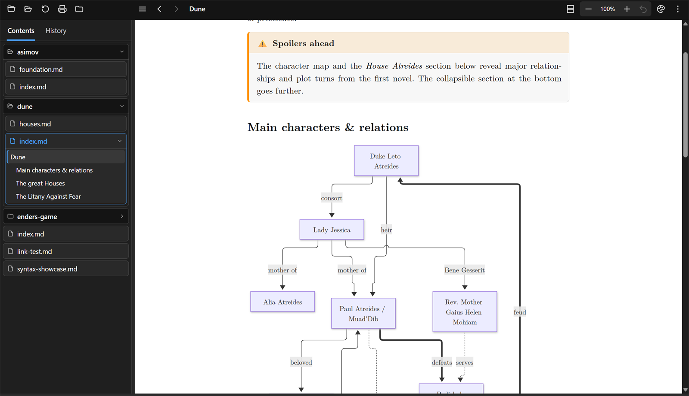
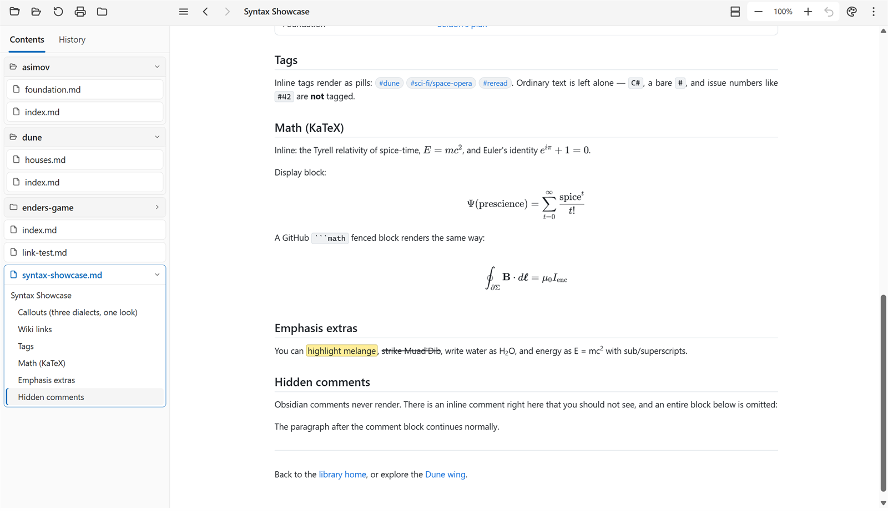

# MarkdownBlaze

A fast, **offline Markdown viewer** — and the rare one that **prints properly**. Point it at a `.md`
file and it renders a clean, navigable document, lays it onto paper the way it will actually print,
and lets you pick how that paper should look. No Electron, no network access, no telemetry: a native
OS WebView driven by **[Photino](https://www.tryphotino.io/) + Blazor** and
**[Microsoft Fluent UI](https://www.fluentui-blazor.net/)** on **.NET 10**.

<p align="center">
  
</p>

> 📖 The [`docs/`](docs/index.md) folder is a self-contained sample wiki that doubles as a feature
> tour. Open it with `MarkdownBlaze docs/`.

## Screenshots

| | |
|:---:|:---:|
| <br>**Eleven document themes**, from the toolbar or `F9` | <br>**Print bar** — pick the look for this one print |
| <br>**Page view** — the document on paper, before you print | <br>**Academic** — the look of a typeset paper |
| <br>**Code**, tables and callouts | <br>**Math**, tags and Obsidian syntax |

<details>
<summary>Tables and diagrams, light appearance</summary>
<p align="center"></p>
</details>

---

## Features

### The document, your way

- **Eleven document themes** — Book, Classic, Elegant, Newspaper, Academic, Report, Modern, Simple,
  Writer, Typewriter and Night, plus *Follow app theme*. Each changes the paper colour, the typeface
  and the spacing of the **document only**: the toolbar and sidebar keep the appearance you chose.
  Pick one from the toolbar or step through them with `F9`.
- **Consistent typography** — every theme sets its text in a single typeface and its code in one
  other, keeps body text the same size however deeply it is nested, and uses the same modest
  heading scale.
- **Justified, hyphenated text** in the document's own language — recognised from the text (English,
  French, German, Spanish, Dutch, Italian, Portuguese, Czech, Swedish, Danish, Norwegian) or
  stated with `lang:` in the front matter.
- **Two views** — **Continuous**, one column that scrolls, and **Pages**, the document laid onto A4
  sheets with real print margins and page breaks, fitted either to the pane's width or to a whole
  sheet. `F2` cycles. Page view is a live preview of the printed result.
- **Zoom the document, not the app** — `Ctrl` + wheel, `Ctrl +` / `Ctrl -`, a trackpad pinch, or the
  toolbar's `− 100% + ↺`. The window itself never scales, so the interface stays where you put it.
- **Blocks stay in the column** — diagrams scale to it and wide tables fit it. In *Follow app theme*
  code keeps its lines as written and scrolls sideways when one runs long; under a document theme,
  in page view and on paper, long lines of code wrap, because a sheet cannot be scrolled.

### Printing

- `Ctrl + P` opens a bar along the bottom to choose the theme **for that one print**; the document
  changes as you look at it, so you see what the printer will produce. `Ctrl + P` again sends it.
- Only the document is printed — no toolbar, no sidebar, no menus. The app's dark appearance never
  reaches the paper: *Follow app theme* prints in its light palette, and a document theme prints as
  itself, with syntax highlighting and Mermaid diagrams re-drawn to match.
- Code wraps, diagrams scale and tables shrink to the sheet, because paper cannot be scrolled.
- Printing without backgrounds still works: code, callouts, highlights, tags and table headers are
  outlined as well as tinted, so every box stays visible.

### Navigating

- **Folder panels** — the sidebar's *Contents* tab shows the folder you are reading as nested,
  collapsible panels: one per folder, one per document. The current document's panel holds its own
  headings as a tree, so files and folders are never mistaken for what is inside them, and the
  heading of the section you are reading is marked as you scroll.
- **The folder you point at is the root.** Open a file and you get its folder; open a folder and it
  reads that folder's `index`, `main` or `readme`, else the first document alphabetically. Following
  a link never moves the root.
- **History** that keeps its order — entries stay where you last saw them instead of jumping to the
  top when reopened. Right-click for *Open*, *Open in new window*, *Copy filename*, *Open containing
  folder*.
- **Smart link rewriting** relative to the opened file: extension-less links and `[[wiki links]]` get
  `.md`; folder links resolve to `index.md`. Local links open in-app, external ones in your browser.
- **Auto-refresh** — edit the file and the view reloads, keeping your place and your zoom.

### Rendering

- **CommonMark + extensions** via [Markdig](https://github.com/xoofx/markdig): tables, task lists,
  footnotes, definition lists, auto-identifiers, `==highlight==`, `~~strikethrough~~`, sub/superscript.
- **Syntax highlighting** with a bundled [highlight.js](https://highlightjs.org/) (~190 languages),
  following the document's theme rather than the app's.
- **Math** via bundled [KaTeX](https://katex.org/) — inline `$…$`, display `$$…$$`, ` ```math ` blocks.
- **Mermaid diagrams**, re-drawn whenever the document's theme changes so they never sit dark on a
  light page.
- **Admonitions / callouts** in Docusaurus (`:::tip`), MkDocs (`!!! note`) **and** GitHub/Obsidian
  (`> [!note]`, collapsible `> [!tip]-`) syntaxes.
- **Emoji shortcodes**, **YAML front matter** parsed and hidden, local **images inlined** as data URIs.

#### Obsidian / GitHub flavour

- **Wiki links** — `[[Page]]`, `[[Page|alias]]`, `[[Page#Heading]]` navigate in-app; `![[img.png]]`
  inlines; `![[Note]]` becomes a link.
- **Tags** — `#project`, `#todo/study` render as pills (`C#` and `#123` are correctly ignored).
- **Comments** — Obsidian `%%…%%`, inline and fenced, are hidden.

Rendering comes from the standalone
[`bwets.Markdig.Extensions`](https://github.com/bwets/bwets.Markdig.Extensions) package.

### Fitting into the desktop

- **Explorer right-click** — *Open with MarkdownBlaze* on Markdown files **and on folders**.
- **`markdown://` links** — the address of the document you are reading is a working link, so
  anything that can open a URL can hand a document over: `markdown://C:/notes/Report.md`.
- Both register themselves on first run under `HKEY_CURRENT_USER` — no elevation, nothing to switch
  on — and repair themselves if the app moves. Linux and macOS packages register the handler through
  the `.desktop` entry and `Info.plist`.
- **Remembers** window size, position, maximized state, sidebar width, view, theme and zoom.

### Getting to know it

- **Guided tour** — on first start, a few tooltips point at the main features. It can be skipped at
  any step, put off until the next launch, and run again from *Settings*.
- **What's new** — a version-by-version list of changes, under the ⋮ menu.
- **A welcome manual** opens when the app is started without a file.

### Keyboard shortcuts

| Shortcut | Action |
|---|---|
| `Alt + ←` / `Alt + →` | Back / Forward |
| `Ctrl + O` / `Ctrl + Shift + O` | Open a file / a folder |
| `F2` / `Shift + F2` | Next / previous view |
| `F9` / `Shift + F9` | Next / previous document theme |
| `Ctrl` + wheel, `Ctrl +` / `Ctrl -` | Zoom the document (`Ctrl 0` resets) |
| `Ctrl + P` | Print — once to choose a theme, again to print |
| `F5` / `Ctrl + R` | Refresh |
| `Ctrl + B` / `F1` | Toggle sidebar |
| `F11` | Fullscreen (`Esc` leaves it) |
| `?` | All shortcuts |

---

## Getting started

### Prerequisites

- [.NET 10 SDK](https://dotnet.microsoft.com/)
- **Windows:** the [WebView2 Runtime](https://developer.microsoft.com/microsoft-edge/webview2/)
  (preinstalled on current Windows)
- **Linux:** WebKitGTK + GTK — `webkit2gtk-4.1` and `gtk3`
  (Arch/CachyOS: `sudo pacman -S --needed gtk3 webkit2gtk-4.1 dbus`)

### Build & run

```bash
dotnet run --project src/MarkdownBlaze -- "docs/index.md"   # a file
dotnet run --project src/MarkdownBlaze -- "docs"            # or a whole folder
```

### Releases & packaging

Prebuilt, self-contained binaries (Windows zip/installer/MSIX, Linux `tar.gz`/`.deb`/`.pkg.tar.zst`,
macOS `.dmg`) come from the manual [`release` workflow](packaging/README.md). On Linux,
`packaging/linux/install-linux.sh` installs the `.desktop` entry and registers MarkdownBlaze for
`.md` files and `markdown://` links.

---

## Tech stack

- **.NET 10**, **PhotinoX.Blazor 5** (native OS WebView host), **Microsoft Fluent UI Blazor 5**
- **Markdig** + **bwets.Markdig.Extensions** for Markdown → HTML
- **highlight.js**, **Mermaid** and **KaTeX**, all bundled for offline use

## Project layout

```
docs/                       Sample wiki / feature showcase
resources/                  Logo artwork, and the screenshots this README shows
scripts/
  build-highlight-content.sh  Rebuilds the highlight.js palette keyed to the document's theme
src/
  MarkdownBlaze/
    Program.cs              Photino + Blazor host, markdown:// scheme, shell integration
    App.razor               Root (app appearance, view switch)
    ViewerView.razor        Toolbars, sidebar panels and outline, print bar, view modes, zoom,
                            What's new, rating bar
    SettingsView.razor      Settings page
    Ico.razor               The toolbar and sidebar icons
    UserManual.md           The manual shown when no file is given
    WhatsNew.md             What changed, one section per app version (⋮ → What's new)
    Services/
      MarkdownService       Markdown → HTML, startup file/folder resolution, app version
      NavigationService     Current document, back/forward, links, file watching
      FileWatcher           Reloads the open document when another program saves it
      FileTreeService       The folder being read, as lazily-read folder and document panels
      ContentThemes         The document themes and their light/dark character
      DocumentLanguage      The language a document is written in, for hyphenation
      ViewModes             Continuous vs page view
      PreferencesStore      Settings kept between launches
      HistoryStore          Persisted history, order preserved
      RatingPrompt          The one-time request to rate the app in the Microsoft Store
      ShellIntegration      Explorer verbs and the markdown:// handler
      UriScheme             markdown:// addresses, both directions
      WindowHost            The native window, for the OS file and folder dialogs
      WindowStateService    Window size, position and fullscreen
      JsBridge              Calls coming back from the page's JavaScript
    wwwroot/
      app.css               App chrome, page view, print rules
      app.js                Rendering, pagination, zoom, printing, guided tour
      lib/                  Offline highlight.js, Mermaid and KaTeX; the document themes
                            (content-themes.css) and the one bundled typeface
packaging/                  Windows installer/MSIX, winget, Microsoft Store listing,
                            Linux .desktop/.deb/PKGBUILD, macOS .app/.dmg
.github/workflows/          The manual release workflow
```

## License

Personal project — all rights reserved unless stated otherwise.
