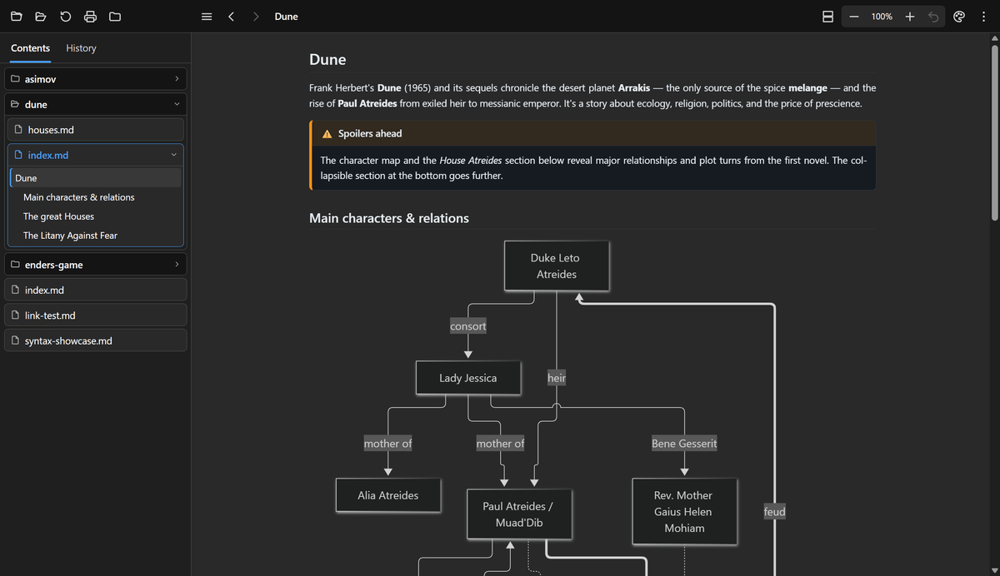
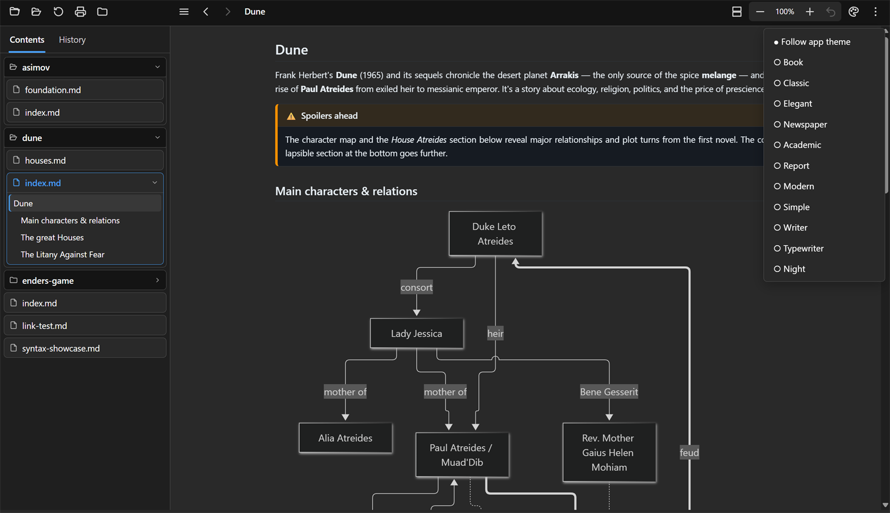
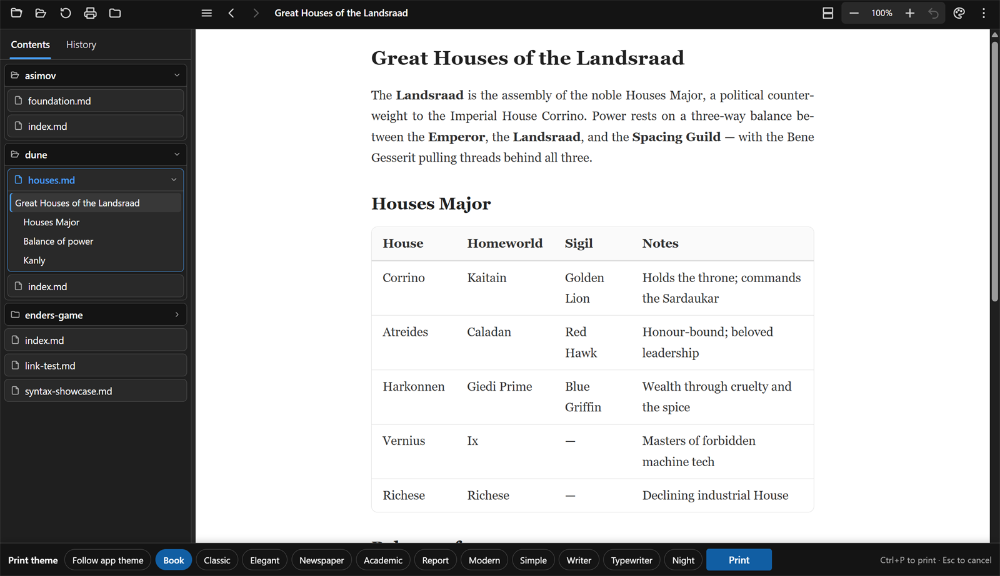
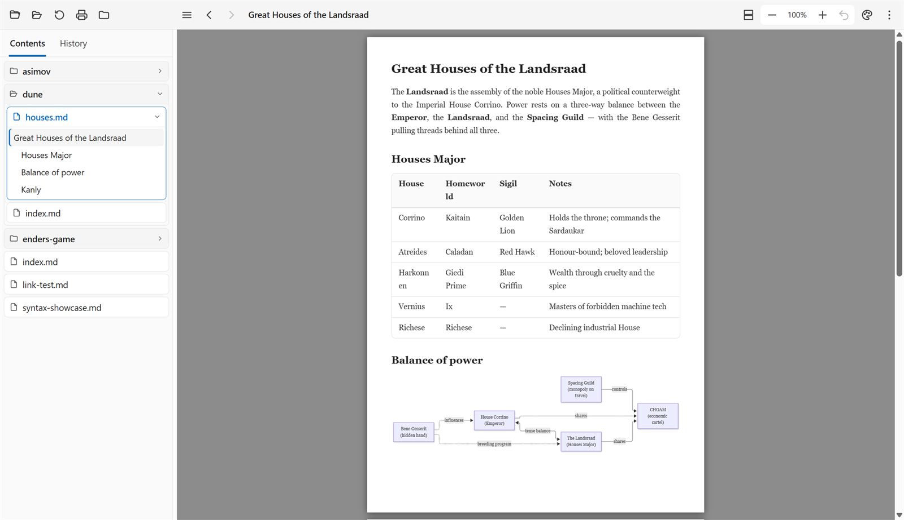
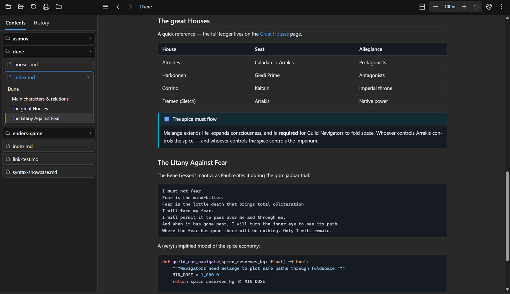
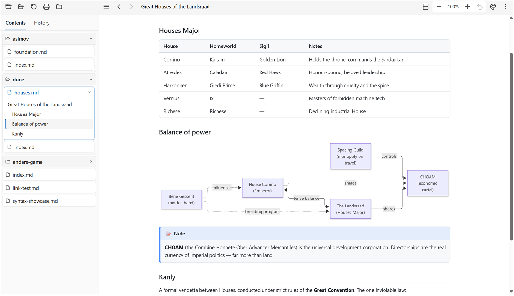

# MarkdownBlaze

A fast, **offline Markdown viewer** — and the rare one that **prints properly**. Point it at a `.md`
file and it renders a clean, navigable document, lays it onto paper the way it will actually print,
and lets you pick how that paper should look. No Electron, no telemetry, and no network requests of its own — the only time anything leaves your machine is when a document you open references a resource on the web, such as a remote image, and the WebView fetches it like a browser would: a native
OS WebView driven by **[Photino](https://www.tryphotino.io/) + Blazor** and
**[Microsoft Fluent UI](https://www.fluentui-blazor.net/)** on **.NET 10**.

<p align="center">
  
</p>

> 📖 The [`samples/wiki/`](samples/wiki/index.md) folder is a self-contained sample wiki that doubles as a
> feature tour. Open it with `MarkdownBlaze samples/wiki/`.

## Screenshots

| | |
|:---:|:---:|
| <br>**Eleven document themes**, from the toolbar or `F9` | <br>**Print bar** — pick the look for this one print |
| <br>**Page view** — the document on paper, before you print | <br>**Academic** — the look of a typeset paper |
| <br>**Code**, tables and callouts | <br>**Math**, tags and Obsidian syntax |

<details>
<summary>Tables and diagrams, light appearance</summary>
<p align="center"></p>
</details>

---

## Features

### The document, your way

- **Eleven document themes** — Book, Classic, Elegant, Newspaper, Academic, Report, Modern, Simple,
  Writer, Typewriter and Night, plus *Follow app theme*. Each changes the paper colour, the typeface
  and the spacing of the **document only**: the toolbar and sidebar keep the appearance you chose.
  Pick one from the toolbar or step through them with `F9`.
- **Consistent typography** — every theme sets its text in a single typeface and its code in one
  other, keeps body text the same size however deeply it is nested, and uses the same modest
  heading scale.
- **Justified, hyphenated text** in the document's own language — recognised from the text (English,
  French, German, Spanish, Dutch, Italian, Portuguese, Czech, Swedish, Danish, Norwegian) or
  stated with `lang:` in the front matter.
- **Two views** — **Continuous**, one column that scrolls, and **Pages**, the document laid onto A4
  sheets with real print margins and page breaks, fitted either to the pane's width or to a whole
  sheet. `F2` cycles. Page view is a live preview of the printed result.
- **Zoom the document, not the app** — `Ctrl` + wheel, `Ctrl +` / `Ctrl -`, a trackpad pinch, or the
  toolbar's `− 100% + ↺`. The window itself never scales, so the interface stays where you put it.
- **Blocks stay in the column** — diagrams scale to it and wide tables fit it. In *Follow app theme*
  code keeps its lines as written and scrolls sideways when one runs long; under a document theme,
  in page view and on paper, long lines of code wrap, because a sheet cannot be scrolled.

### Printing

- `Ctrl + P` opens a bar along the bottom to choose the theme **for that one print**; the document
  changes as you look at it, so you see what the printer will produce. `Ctrl + P` again sends it.
- Only the document is printed — no toolbar, no sidebar, no menus. The app's dark appearance never
  reaches the paper: *Follow app theme* prints in its light palette, and a document theme prints as
  itself, with syntax highlighting and Mermaid diagrams re-drawn to match.
- Code wraps, diagrams scale and tables shrink to the sheet, because paper cannot be scrolled.
- Printing without backgrounds still works: code, callouts, highlights, tags and table headers are
  outlined as well as tinted, so every box stays visible.

### Navigating

- **Folder panels** — the sidebar's *Contents* tab shows the folder you are reading as nested,
  collapsible panels: one per folder, one per document. The current document's panel holds its own
  headings as a tree, so files and folders are never mistaken for what is inside them, and the
  heading of the section you are reading is marked as you scroll.
- **The folder you point at is the root.** Open a file and you get its folder; open a folder and it
  reads that folder's `index`, `main` or `readme`, else the first document alphabetically. Following
  a link never moves the root.
- **History** that keeps its order — entries stay where you last saw them instead of jumping to the
  top when reopened. Right-click for *Open*, *Open in new window*, *Copy filename*, *Open containing
  folder*.
- **Smart link rewriting** relative to the opened file: extension-less links and `[[wiki links]]` get
  `.md`; folder links resolve to `index.md`. Local links open in-app, external ones in your browser.
- **Auto-refresh** — edit the file and the view reloads, keeping your place and your zoom.

### Rendering

- **CommonMark + extensions** via [Markdig](https://github.com/xoofx/markdig): tables, task lists,
  footnotes, definition lists, auto-identifiers, `==highlight==`, `~~strikethrough~~`, sub/superscript.
- **Syntax highlighting** with a bundled [highlight.js](https://highlightjs.org/) (~190 languages),
  following the document's theme rather than the app's.
- **Math** via bundled [KaTeX](https://katex.org/) — inline `$…$`, display `$$…$$`, ` ```math ` blocks.
- **Mermaid diagrams**, re-drawn whenever the document's theme changes so they never sit dark on a
  light page.
- **Admonitions / callouts** in Docusaurus (`:::tip`), MkDocs (`!!! note`) **and** GitHub/Obsidian
  (`> [!note]`, collapsible `> [!tip]-`) syntaxes.
- **Emoji shortcodes**, **YAML front matter** parsed and hidden, local **images** served straight from disk
  by the app.

#### Obsidian / GitHub flavour

- **Wiki links** — `[[Page]]`, `[[Page|alias]]`, `[[Page#Heading]]` navigate in-app; `![[img.png]]`
  inlines; `![[Note]]` becomes a link.
- **Tags** — `#project`, `#todo/study` render as pills (`C#` and `#123` are correctly ignored).
- **Comments** — Obsidian `%%…%%`, inline and fenced, are hidden.

Rendering comes from the standalone
[`bwets.Markdig.Extensions`](https://github.com/bwets/bwets.Markdig.Extensions) package.

#### Safe with documents you did not write

A Markdown file can come from anywhere, so the app treats it as untrusted. Raw HTML is cleaned by an
allow-list (no scripts, frames, forms or event handlers, and none of the names the app uses for its own toolbar and menus),
cut to the depth a browser would show, a Content-Security-Policy confines the page, only
web, mail, phone and FTP links are handed to the system (nothing that starts a program or reaches a network
share), only real image files are shown, a link shows where it really goes before it is clicked, a page that takes
more than 30 seconds to render is given up on, and the web view's developer tools and menus are off. The
`samples/wiki/security/` pages try each of these attacks; [docs/architecture.md](docs/architecture.md) explains
the layers.

### Fitting into the desktop

- **Explorer** — MarkdownBlaze is offered under *Open with* for `.md`, `.markdown` and `.mdx` files (and
  can be made the default in *Settings → Default apps*), and *Open with MarkdownBlaze* is on **folders**.
- **`markdown://` links** — the address of the document you are reading is a working link, so
  anything that can open a URL can hand a document over: `markdown://C:/notes/Report.md`.
- **Who registers it** (Windows; all under `HKEY_CURRENT_USER`, so no elevation):
  - The **installer** registers all of it, and removes all of it again when uninstalled.
  - The **portable zip** registers nothing until you ask: *Settings → Windows integration → Add to
    Explorer and register markdown:// links*, or from a script `MarkdownBlaze.exe --register`. *Remove*
    in the same place, or `MarkdownBlaze.exe --unregister`, takes it away again. (Both switches do their
    work without opening a window; the exit code is 0 when done, 1 if the registry refused, 2 if they do
    not apply.)
  - The **Microsoft Store** package declares the file types and the `markdown` link in its manifest;
    the app leaves the registry alone.

  The app never registers itself on its own at startup. Linux and macOS packages register the handler
  through the `.desktop` entry and `Info.plist`.
- **Remembers** window size, position, maximized state, sidebar width, view, theme and zoom.
- **A log** of what goes wrong quietly (a file that could not be read, a link that did not open) in
  `%LOCALAPPDATA%\MarkdownBlaze\logs` (under `~/.local/share` on Linux), kept small and
  local; *Settings* shows where it is. It never leaves your machine — see [PRIVACY.md](PRIVACY.md).

### Getting to know it

- **Guided tour** — on first start, a few tooltips point at the main features. It can be skipped at
  any step, put off until the next launch, and run again from *Settings*.
- **What's new** — a version-by-version list of changes, under the ⋮ menu.
- **A welcome manual** opens when the app is started without a file.

### Keyboard shortcuts

| Shortcut | Action |
|---|---|
| `Alt + ←` / `Alt + →` | Back / Forward |
| `Ctrl + O` / `Ctrl + Shift + O` | Open a file / a folder |
| `F2` / `Shift + F2` | Next / previous view |
| `F9` / `Shift + F9` | Next / previous document theme |
| `Ctrl` + wheel, `Ctrl +` / `Ctrl -` | Zoom the document (`Ctrl 0` resets) |
| `Ctrl + P` | Print — once to choose a theme, again to print |
| `F5` / `Ctrl + R` | Refresh |
| `Ctrl + B` / `F1` | Toggle sidebar |
| `F11` | Fullscreen (`Esc` leaves it) |
| `?` | All shortcuts |

---

## Getting started

### Prerequisites

- [.NET 10 SDK](https://dotnet.microsoft.com/)
- **Windows:** the [WebView2 Runtime](https://developer.microsoft.com/microsoft-edge/webview2/)
  (preinstalled on current Windows)
- **Linux:** WebKitGTK + GTK — `webkit2gtk-4.1` and `gtk3`
  (Arch/CachyOS: `sudo pacman -S --needed gtk3 webkit2gtk-4.1 dbus`)

### Build & run

```bash
dotnet run --project src/MarkdownBlaze -- "samples/wiki/index.md"   # a file
dotnet run --project src/MarkdownBlaze -- "samples/wiki"            # or a whole folder
```

### Command line

Switches go **before** the file or folder: anything after the first file name is read as a file name, never as a
switch (so an address someone else wrote cannot add switches of its own).

| Argument | Effect |
|---|---|
| `<file>` or `<folder>` | Open it (a folder opens its `index`, `main` or `readme`, else the first document). A `markdown://` address is accepted too. |
| `--log-level <level>` | `trace`, `debug`, `information` (default), `warning`, `error`, `critical` or `none`. |
| `--devtools` | Turn the web view's developer tools on (`F12`) in a release build; a debug build always has them. |
| `--register` / `--unregister` | Windows only: add or remove the Explorer and `markdown://` registration and exit without opening a window. Exit code 0 done, 1 the registry refused, 2 not applicable (not Windows, or the Store package). |

### Releases & packaging

Prebuilt, self-contained binaries (Windows zip/installer/MSIX, Linux `tar.gz`/`.deb`/`.pkg.tar.zst`,
macOS `.dmg`) come from the manual [`release` workflow](packaging/README.md). On Linux,
`packaging/linux/install-linux.sh` installs the `.desktop` entry and registers MarkdownBlaze for
`.md` files and `markdown://` links.

---

## Tech stack

- **.NET 10**, **PhotinoX.Blazor 5** (native OS WebView host), **Microsoft Fluent UI Blazor 5**
- **Markdig** + **bwets.Markdig.Extensions** for Markdown → HTML
- **highlight.js**, **Mermaid** and **KaTeX**, all bundled for offline use

## Project layout

```
branding/                   The icon (icon-1024.png is the master; icon-32 … icon-512.png and icon.svg
                            are derived from it), and the screenshots this README shows
docs/                       Project documentation: architecture.md (the invariants and the trust boundary)
samples/wiki/               The sample wiki / feature showcase, with the hostile-but-harmless pages in security/
scripts/                    Maintenance scripts (see scripts/README.md): vendor update, highlight palette
packaging/                  Windows installer/MSIX, winget, Microsoft Store listing,
                            Linux .desktop/.deb, Arch PKGBUILD, macOS .app/.dmg
tests/
  MarkdownBlaze.Tests/      xUnit tests (sanitizer, links, paths, services, the sample pages)
  fixtures/                 Documents the tests render
.github/workflows/          ci.yml (build, format, test on every push) and the manual release workflow
src/
  MarkdownBlaze.slnx        What `dotnet build src` loads: the app and the tests, nothing outside this repository
  MarkdownBlaze.Dev.slnx    The same plus the sibling bwets.Markdig.Extensions checkout (needs LocalSources=true)
  MarkdownBlaze/
    Program.cs              Photino + Blazor host, markdown:// scheme, startup
    Assets/                 icon.ico and icon.png, shipped next to the executable for the window icon
    Content/                UserManual.md (shown when no file is given), WhatsNew.md (⋮ → What's new);
                            copied flat into the output folder
    Components/
      App.razor             Root: app appearance, the viewer, Settings drawn over it
      Viewer/               ViewerView (layout only), Toolbar, and what they run on: ViewerState (zoom, view,
                            theme, open popups), Commands (the registry the keyboard and the shortcuts
                            overlay are both drawn from), ViewerActions, ViewerMenus
      Sidebar/              Sidebar, FolderTree, TreePanel (recursive), Outline, HistoryList
      Overlays/             ContextMenu, WhatsNewDialog, ShortcutsDialog, PrintBar, Toast, RateBar, MissingFileBar
      Settings/SettingsView The settings page
      Shared/               Icon, FocusScope (keyboard focus for popups)
    Models/                 Preferences (with ThemeMode, ViewMode, PageFit kept as the strings the file has always
                            held), HistoryEntry, Heading, RenderResult, TreeNode, ContentTheme, …
    Services/
      MarkdownService       Markdown → HTML, startup file/folder resolution, app version
      ReferenceResolver     Which links go where and which pictures are shown, on the sanitized HTML
      NavigationService     Current document, back/forward, links, file watching, the render deadline
      RenderWorker          Renders on a thread of their own, with a 64 MB stack
      FileWatcher           Reloads the open document when another program saves it
      FileTreeService       The folder being read, as lazily-read folder and document panels
      ContentThemes         The document themes and their light/dark character
      DocumentLanguage      The language a document is written in, for hyphenation
      ViewModes, EnumText   Continuous vs page view: the names the page and the preferences file use for the enums
      PreferencesStore      Settings kept between launches
      HistoryStore          Persisted history, order preserved
      WindowStateService    Window size, position and fullscreen
      RatingPrompt          The one-time request to rate the app in the Microsoft Store
      UriScheme             markdown:// addresses, both directions
      AppPaths, JsonFile, SaveDebouncer, Log, FileLoggerProvider, IUiDispatcher, Background …
                            Where data lives, atomic debounced saves, the local log, UI-thread marshalling,
                            logging the failure of work nobody awaits
    Security/               HtmlSanitizer, NestingLimit (HTML cut to a browser's depth), ExternalLinks (link allow-list),
                            LocalPath (which files may be read),
                            AssetHandler (serves the open document's pictures over mdasset://)
    Interop/                ViewerInterop (the connection to the page's JavaScript, both ways), PageEvents, NativeDialogs (the OS
                            file and folder dialogs)
    Platform/               IShellLauncher / ShellLauncher (the one place that starts a browser, a new window or
                            the file manager)
    Platform/Windows/       ShellIntegration (Explorer verbs and the markdown:// handler), PackageIdentity, WindowIcon
    wwwroot/
      index.html            The page: splash, Content-Security-Policy, stylesheets, scripts
      css/                  app.css (chrome, page view, print), content-themes.css (the document themes),
                            highlight-theme.css, highlight-content.css (generated)
      js/                   ES modules (main.js, render, pagination, zoom, print, tour, …) with their tests in tests/js
      fonts/latin-modern/   The one bundled typeface (Academic theme)
      vendor/               highlight.js, Mermaid and KaTeX for offline use, with VERSIONS.md and SHA256SUMS
```

## Contributing and security

[CONTRIBUTING.md](CONTRIBUTING.md) covers building, testing and the code rules; [SECURITY.md](SECURITY.md)
says how to report a vulnerability; [docs/architecture.md](docs/architecture.md) explains the design
decisions the code relies on. [THIRD-PARTY-NOTICES.md](THIRD-PARTY-NOTICES.md) lists the libraries and
fonts the app ships, with their licences.

## License

[MIT](LICENSE). The bundled libraries and fonts keep their own licences, listed in
[THIRD-PARTY-NOTICES.md](THIRD-PARTY-NOTICES.md).
