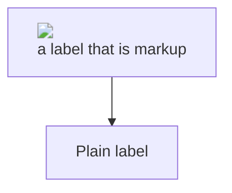
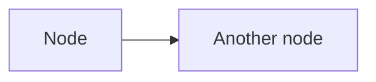
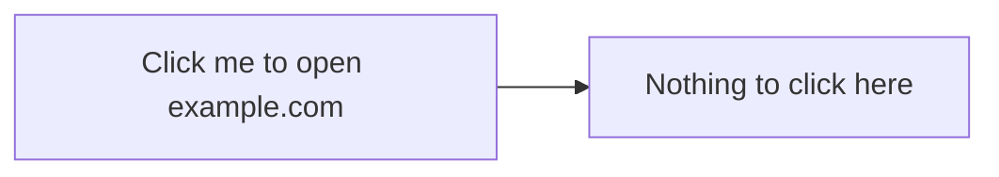
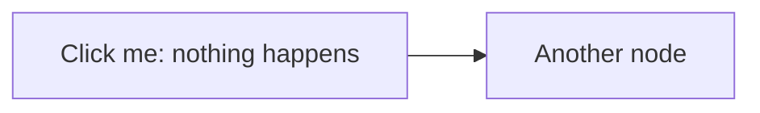
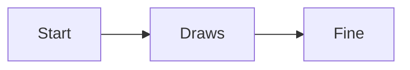

# Diagrams and Math

Diagrams and formulas are not drawn by the viewer: Mermaid draws the diagram and KaTeX sets the formula, in the
page, from text the document supplies. That text is a language of its own — and both languages have ways to ask
for more than a picture: a diagram can carry its own configuration, a link, even a call to a function; a formula
can make a link, load an image, or give an element a class.

The viewer starts Mermaid in its strictest mode and starts KaTeX with every one of those commands off, with limits
on size. These pages are drawn *after* the sanitizer has cleaned the document, so the sanitizer alone cannot help
them; what you are checking here is the configuration. **A dialog box at any point is a failure**, and so is a click
that changes the window's own address.

Each item is the payload, then what you should see.

## Diagrams

### A diagram that asks for less security

Payload: an `init` directive setting `"securityLevel": "loose"`, and a node whose label is an `` tag.
**Expected:** the directive changes nothing — Mermaid keeps `securityLevel`, `maxTextSize` and `maxEdges` out of reach
of the diagram. The first node's label is shown as text, markup and all, and no dialog appears.

### A diagram that brings its own CSS and font

Payload: an `init` directive with a `themeCSS` that tries to hide `body` and the toolbar, and a `fontFamily` that
tries to close its own declaration and start a rule of its own. **Expected:** the toolbar and the page are still
visible. Whatever the style does it does inside this one drawing: Mermaid scopes it to the diagram's own element,
and the viewer's content-security policy lets a style load nothing from outside.

### A link on a node

Payload: `click A "https://example.com" _blank`. Even in strict mode Mermaid turns this into an anchor inside the
drawing. **Expected:** a click on node A opens **your browser** at example.com — through the same list of schemes
as any other link in a document — and the viewer's window stays where it is: it does not navigate and no second
window opens.

### A link that is not a web address

Payload: `click B href "javascript:alert(1)"`. **Expected:** a click does nothing. No dialog, no navigation.

### A callback

Payload: `click C call alert()`, which would call a function of the page. **Expected:** a click does nothing, and no
dialog appears: callbacks are off in strict mode, and the page defines no function of that name for them to call.

## Math

Each formula below uses a command that is switched off. KaTeX is told not to trust the document and not to throw:
the command is shown as red source text where the formula would have been.

### A link made by a formula

$\href{javascript:alert(1)}{click me}$

Payload: `$\href{javascript:alert(1)}{click me}$`. **Expected:** the red text `\href`, not a link; a click does
nothing and no dialog appears.

### A web address made by a formula

$\url{https://example.com}$

Payload: `$\url{https://example.com}$`. **Expected:** the red text `\url`; it is not a link.

### An image loaded by a formula

$\includegraphics[height=1em]{https://example.com/pixel.png}$

Payload: `$\includegraphics[height=1em]{https://example.com/pixel.png}$`. **Expected:** the red text
`\includegraphics`; the page does not ask example.com for a picture (in a debug build, the developer tools'
Network tab shows no request).

### A class chosen by a formula

$\htmlClass{menu-backdrop}{x}$

Payload: `$\htmlClass{menu-backdrop}{x}$`. **Expected:** the red text `\htmlClass`. No element in the page gets the
class (it would cover the window), and the toolbar still answers. The same goes for `\htmlId{md-tree}{x}`:

$\htmlId{md-tree}{x}$

## What should still work

An ordinary diagram, and an ordinary formula, draw as usual:

$$\int_0^1 x^2\,dx = \tfrac{1}{3}$$
