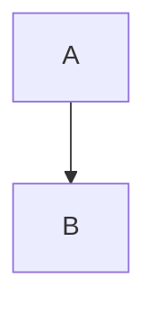

# Title {#custom}

<details><summary>Open me</summary>

Press <kbd>Ctrl</kbd> + <kbd>P</kbd>, it is <mark>marked</mark>.

</details>

- [ ] open task
- [x] done task

| Left | Centre | Right |
|:-----|:------:|------:|
| a    | b      | c     |

```csharp
var x = 1;
```



Footnote[^1].

[^1]: The note.
